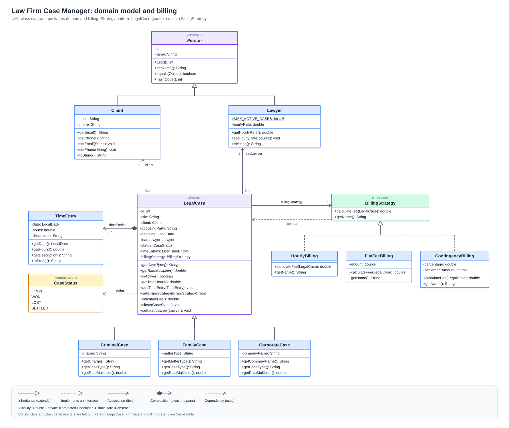
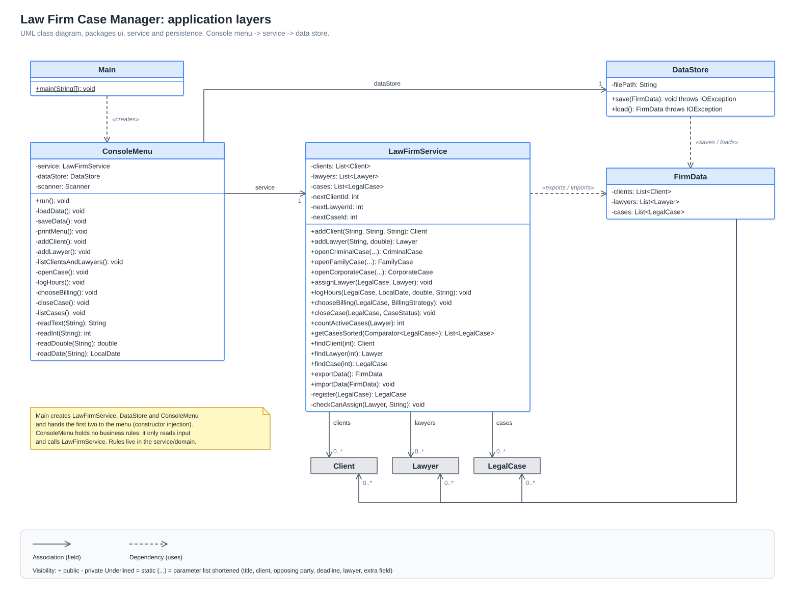
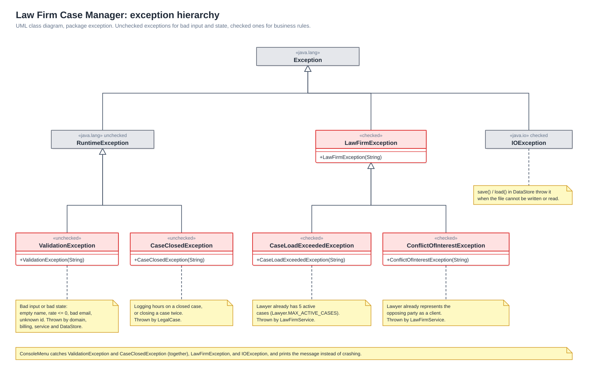

# Law Firm Case Manager

A Java console application for a small law firm. Office staff can register clients and lawyers, open cases, log billable hours, choose how each case is billed, close cases with an outcome and list cases in different orders. All data is saved to a file when the program exits and loaded again on the next start.

**Problem it solves:** small firms often keep this information in spreadsheets, which makes it easy to give a lawyer too many cases, miss a conflict of interest, or calculate a fee wrongly. This application keeps everything in one place and checks the firm's rules automatically:

- a lawyer can lead at most **5 active cases** at the same time;
- a lawyer cannot take a case **against one of their own clients** (conflict of interest);
- hours cannot be logged on a closed case, and a case cannot be closed twice.

User stories with acceptance criteria are in [`docs/user-stories.md`](docs/user-stories.md).

## Prerequisites

- **JDK 25** (the project compiles with `release 25`). Check with `java -version`.
- Maven is **not** required: the project includes the Maven Wrapper (`mvnw` / `mvnw.cmd`), which downloads the correct Maven version the first time it runs. An internet connection is needed for that first run.

## Build, test and run

Run these commands from the project root folder.

| What | Windows | macOS / Linux |
|---|---|---|
| Run all tests | `mvnw.cmd clean test` | `sh mvnw clean test` |
| Build the jar (also runs the tests) | `mvnw.cmd clean package` | `sh mvnw clean package` |
| Start the application | `java -jar target\law-firm-case-manager-1.0.0.jar` | `java -jar target/law-firm-case-manager-1.0.0.jar` |

In IntelliJ IDEA you can also open the project as a Maven project, run `Main` directly, and run the tests by right-clicking `src/test/java` → *Run 'All Tests'*.

Saved data is written to `data/lawfirm-data.ser` (relative to the folder the program is started from). This folder is ignored by Git.

## Sample usage

User input is shown after each prompt.

```
=== Law Firm Case Manager ===
Loaded 0 clients, 0 lawyers and 0 cases.

1. Add client
2. Add lawyer
3. List clients and lawyers
4. Open a case
5. Log hours on a case
6. Choose billing method for a case
7. Close a case
8. List cases (sorted)
0. Save and exit
Choose an option: 1
Name: Anna Kovacs
Email: anna@example.com
Phone: +36 30 123 4567
Added Client #1: Anna Kovacs (anna@example.com, +36 30 123 4567)

Choose an option: 2
Name: Peter Nagy
Hourly rate (EUR): 100
Added Lawyer #1: Peter Nagy (100.00 EUR/hour)

Choose an option: 4
Case type: 1 = Criminal, 2 = Family, 3 = Corporate
Type: 1
Title: Shoplifting charge
Client id: 1
Opposing party: State
Deadline (YYYY-MM-DD): 2026-12-15
Lead lawyer id: 1
Charge: theft
Opened Criminal case #1: Shoplifting charge | client: Anna Kovacs vs State | lead: Peter Nagy | deadline: 2026-12-15 | OPEN | Hourly | fee: 0.00 EUR | charge: theft

Choose an option: 5
Case id: 1
Date (YYYY-MM-DD): 2026-11-04
Hours: 3
Description: First meeting
Logged. Total hours on this case: 3.0

Choose an option: 8
Sort by: 1 = Deadline, 2 = Fee (highest first), 3 = Client name
Sort order: 2
  Criminal case #1: Shoplifting charge | client: Anna Kovacs vs State | lead: Peter Nagy | deadline: 2026-12-15 | OPEN | Hourly | fee: 450.00 EUR | charge: theft

Choose an option: 0
Data saved.
Goodbye!
```

(The menu is printed again before every "Choose an option"; it is left out above to keep the example short.) The fee is 3 hours × 100 EUR × 1.5, because criminal cases have a 1.5 rate multiplier.

Examples of rules being enforced:

```
Refused: Peter Nagy already has 5 active cases.
Refused: Peter Nagy already represents Anna Kovacs and cannot act against them.
Error: Cannot log hours on a closed case.
Error: Email must contain '@'.
```

## Project structure

```
src/main/java/com/mahadin/lawfirm/
├── Main.java          creates the objects and starts the menu
├── domain/            Person, Client, Lawyer, LegalCase and its subclasses, TimeEntry, CaseStatus
├── billing/           BillingStrategy and its three implementations (Strategy pattern)
├── exception/         the application's own exception types
├── service/           LawFirmService: the firm's rules and the lists of data
├── persistence/       FirmData and DataStore: saving and loading
└── ui/                ConsoleMenu: all console input and output
src/test/java/...      JUnit 5 tests, in the same packages as the classes they test
docs/                  user stories and UML class diagram
```

## Implemented requirements

| Requirement | Where |
|---|---|
| **Encapsulation** | All fields are `private`; values are checked in constructors and setters (e.g. `Client.setEmail`, `Lawyer.setHourlyRate`). Lists are returned with `Collections.unmodifiableList`, so other classes cannot change them directly. |
| **Abstraction** | `Person` and `LegalCase` are abstract classes; `BillingStrategy` is an interface. |
| **Inheritance** | `Client` and `Lawyer` extend `Person`. `CriminalCase`, `FamilyCase` and `CorporateCase` extend `LegalCase`. The exceptions extend `LawFirmException` or `RuntimeException`. |
| **Runtime polymorphism** | `LegalCase.getRateMultiplier()` and `getCaseType()` are overridden in each case type. `calculateFee()` calls `BillingStrategy.calculateFee()`, and which implementation runs depends on the object chosen at runtime. |
| **Relationships and multiplicities** | A case has exactly 1 client and exactly 1 lead lawyer; a client or lawyer can have 0..* cases; a case has 0..* time entries (composition) and exactly 1 billing strategy. |
| **Collections and generics** | `List<Client>`, `List<Lawyer>`, `List<LegalCase>`, `List<TimeEntry>`. |
| **Sorting** | `LawFirmService.getCasesSorted(Comparator<LegalCase>)` with lambda comparators in `ConsoleMenu` (by deadline, by fee highest first, by client name). |
| **Exception handling** | Own exception types in the `exception` package (see below). Invalid numbers and dates in the menu are caught and the user is asked again. Load and save problems are reported without crashing. |
| **Persistence** | `DataStore` saves and loads a `FirmData` object with Java serialization, using try-with-resources so the file streams are always closed. |
| **Design pattern** | Strategy (see below). |
| **Build tool** | Maven with the Maven Wrapper. |
| **Tests** | JUnit 5 tests for fees, case rules, validation, sorting and saving/loading. |

### Exception types

| Exception | Kind | Used when |
|---|---|---|
| `ValidationException` | unchecked | invalid input, e.g. an empty name, an email without `@`, negative hours, unknown id |
| `CaseClosedException` | unchecked | logging hours on a closed case, or closing a case twice |
| `LawFirmException` | checked | parent class of the two firm-rule exceptions below |
| `CaseLoadExceededException` | checked | the lawyer already leads 5 active cases |
| `ConflictOfInterestException` | checked | the opposing party is one of the lawyer's own clients |

The two firm-rule exceptions are **checked** because breaking a firm rule is a normal situation that the caller must handle (the menu shows "Refused: …"). Invalid input is **unchecked** because it is a mistake in the values passed in, and the menu shows it as "Error: …".

## Design pattern: Strategy

**Problem:** the firm bills cases in three different ways: by the hour, with a fixed fee, or as a percentage of the settlement if the case is won. The billing method can also change while a case is open. Putting all three calculations in `LegalCase` with `if`/`switch` statements would make the class longer every time a new billing method is added.

**Solution:** each billing method is its own class that implements the `BillingStrategy` interface:

| Class | Role |
|---|---|
| `BillingStrategy` | the strategy interface: `calculateFee(LegalCase)` and `getName()` |
| `HourlyBilling` | total hours × lawyer's hourly rate × case-type multiplier (default for new cases) |
| `FlatFeeBilling` | a fixed amount, no matter how many hours |
| `ContingencyBilling` | a percentage of the settlement, but only if the case status is `WON` |
| `LegalCase` | the context: it holds one `BillingStrategy` and its `calculateFee()` just calls the strategy |

**Benefit:** `LegalCase` does not need to know how any fee is calculated. The billing method can be changed at runtime with `setBillingStrategy(...)` (menu option 6). A new billing method can be added by writing one new class, without changing `LegalCase` or the other strategies.

## Design decisions

- **Layers:** the UI (`ConsoleMenu`) only reads input and prints output. The firm's rules are in `LawFirmService`, the data classes are in `domain`, and file handling is in `persistence`. This keeps each class focused on one job.
- **`Person` base class:** `Client` and `Lawyer` both have an id and a name with the same checks, so this code is written once in `Person`.
- **Rate multiplier per case type:** criminal 1.5, family 1.0, corporate 1.3. Each subclass returns its own value, so hourly billing works the same way for every case type.
- **Equality by id:** two clients (or two lawyers, or two cases) are equal if they have the same id. Ids are given out by `LawFirmService` and continue correctly after loading saved data.
- **One save file:** all data is wrapped in a single `FirmData` object, so the relationships between objects (for example a case pointing to its client) are saved and restored together.

## Known limitations

- Data is only saved when the user exits with option 0. If the program is closed in another way (for example the window is closed), the changes from that session are lost.
- If the save file is damaged or comes from an older version of the program, it cannot be loaded. The program then starts with empty data, and saving on exit replaces the old file.
- Clients and lawyers cannot be edited or deleted from the menu, and cases cannot be reopened.
- The conflict-of-interest check compares names (ignoring upper/lower case), so two different people with the same name are treated as the same person.
- Only one lead lawyer per case is stored.
- Console interface only, no GUI.

## UML class diagram

The class diagrams are in the [`docs/`](docs/) folder as three views. The editable source is [`docs/class-diagram.drawio`](docs/class-diagram.drawio) (open it at diagrams.net, one page per view).

**Domain model and billing** (Strategy pattern: `LegalCase` uses a `BillingStrategy`)



**Application layers**



**Exception hierarchy**



## Contributor

- Hussein ALMahadin

## License

This project is licensed under the MIT License; see [LICENSE](LICENSE).
