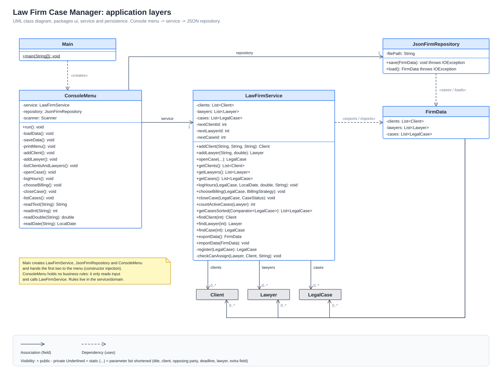

# Law Firm Case Manager

**Author:** Hussein ALMahadin  
**Neptun code:** ZY39QA

A Java application for a small law firm with **two interfaces to the same program: a console menu and a web page (GUI)**. Office staff can register clients and lawyers, open cases, log billable hours, choose how each case is billed, close cases with an outcome and list cases in different orders. All data is saved to a JSON file and loaded again on the next start (the console saves when you exit, the web page after every change).

**Problem it solves:** small firms often keep this information in spreadsheets, which makes it easy to give a lawyer too many cases, miss a conflict of interest, or calculate a fee wrongly. This application keeps everything in one place and checks the firm's rules automatically:

- a lawyer can lead at most **5 active cases** at the same time;
- a lawyer cannot take a case **against one of their own clients** (conflict of interest);
- hours cannot be logged on a closed case, and a case cannot be closed twice.

User stories with acceptance criteria are in [`docs/user-stories.md`](docs/user-stories.md).

## Prerequisites

- **JDK 25** (the project compiles with `release 25`). Check with `java -version`.
- Maven is **not** required: the project includes the Maven Wrapper (`mvnw` / `mvnw.cmd`), which downloads the correct Maven version the first time it runs. An internet connection is needed for that first run.

## Build, test and run

Run these commands from the project root folder.

| What | Windows | macOS / Linux |
|---|---|---|
| Run all tests | `mvnw.cmd clean test` | `sh mvnw clean test` |
| Build the jar (also runs the tests) | `mvnw.cmd clean package` | `sh mvnw clean package` |
| Start the console menu | `java -jar target\law-firm-case-manager-1.0.0.jar` | `java -jar target/law-firm-case-manager-1.0.0.jar` |
| Start the web page (GUI) | `java -jar target\law-firm-case-manager-1.0.0.jar --web` | `java -jar target/law-firm-case-manager-1.0.0.jar --web` |

In IntelliJ IDEA you can also open the project as a Maven project, run `Main` directly, and run the tests by right-clicking `src/test/java` → *Run 'All Tests'*.

### Two interfaces

| | Console menu | Web page (GUI) |
|---|---|---|
| Start | no argument | `--web`, then open http://localhost:8080 |
| What it is | a numbered text menu (`ConsoleMenu`) | an HTML page with Bootstrap, forms and tables, served by `WebServer` |
| Features | every action: add clients and lawyers, open cases, log hours, choose billing, close cases, list cases sorted | the same actions, plus a sortable case table and the lists of clients and lawyers |
| Saving | when you exit with option 0 | after every change; stop with Ctrl+C |

Both interfaces call the same `LawFirmService` and use the same save file, so the rules are written once and the data is the same in both. The web page loads Bootstrap from the internet, so it needs a connection to look styled.

Saved data is written as a readable JSON file, `data/lawfirm-data.json` (relative to the folder the program is started from). This folder is ignored by Git.

## Sample usage (console menu)

User input is shown after each prompt.

```
=== Law Firm Case Manager ===
Loaded 0 clients, 0 lawyers and 0 cases.

1. Add client
2. Add lawyer
3. List clients and lawyers
4. Open a case
5. Log hours on a case
6. Choose billing method for a case
7. Close a case
8. List cases (sorted)
0. Save and exit
Choose an option: 1
Name: Anna Kovacs
Email: anna@example.com
Phone: +36 30 123 4567
Added Client #1: Anna Kovacs (anna@example.com, +36 30 123 4567)

Choose an option: 2
Name: Peter Nagy
Hourly rate (EUR): 100
Added Lawyer #1: Peter Nagy (100.00 EUR/hour)

Choose an option: 4
Case type: 1 = Criminal, 2 = Family, 3 = Corporate
Type: 1
Title: Shoplifting charge
Client id: 1
Opposing party: State
Deadline (YYYY-MM-DD): 2026-12-15
Lead lawyer id: 1
Charge: theft
Opened Criminal case #1: Shoplifting charge | client: Anna Kovacs vs State | lead: Peter Nagy | deadline: 2026-12-15 | OPEN | Hourly | fee: 0.00 EUR | charge: theft

Choose an option: 5
Case id: 1
Date (YYYY-MM-DD): 2026-11-04
Hours: 3
Description: First meeting
Logged. Total hours on this case: 3.0

Choose an option: 8
Sort by: 1 = Deadline, 2 = Fee (highest first), 3 = Client name
Sort order: 2
  Criminal case #1: Shoplifting charge | client: Anna Kovacs vs State | lead: Peter Nagy | deadline: 2026-12-15 | OPEN | Hourly | fee: 450.00 EUR | charge: theft

Choose an option: 0
Data saved.
Goodbye!
```

(The menu is printed again before every "Choose an option"; it is left out above to keep the example short.) The fee is 3 hours × 100 EUR × 1.5, because criminal cases have a 1.5 rate multiplier.

Examples of rules being enforced:

```
Refused: Peter Nagy already has 5 active cases.
Refused: Peter Nagy already represents Anna Kovacs and cannot act against them.
Error: Cannot log hours on a closed case.
Error: Email must contain '@'.
```

## Project structure

```
src/main/java/com/mahadin/lawfirm/
├── Main.java          creates the objects and starts the console menu (or the web page with --web)
├── domain/            Person, Client, Lawyer, LegalCase and its subclasses, TimeEntry, CaseStatus
├── billing/           BillingStrategy and its three implementations (Strategy pattern)
├── exception/         the application's own exception types
├── service/           LawFirmService: the firm's rules and the lists of data
├── persistence/       FirmData, JsonFirmRepository (the JSON storage)
└── ui/                ConsoleMenu: the console interface; WebServer: the web interface (GUI)
src/main/resources/web/index.html   the Bootstrap page served by WebServer
src/test/java/...      JUnit 5 tests, in the same packages as the classes they test
docs/                  user stories and UML class diagram
```

## Implemented requirements

| Requirement | Where |
|---|---|
| **Encapsulation** | All fields are `private`; values are checked in constructors and setters (e.g. `Client.setEmail`, `Lawyer.setHourlyRate`). Lists are returned with `Collections.unmodifiableList`, so other classes cannot change them directly. |
| **Abstraction** | `Person` and `LegalCase` are abstract classes; `BillingStrategy` is an interface. |
| **Inheritance** | `Client` and `Lawyer` extend `Person`. `CriminalCase`, `FamilyCase` and `CorporateCase` extend `LegalCase`. The exceptions extend `LawFirmException` or `RuntimeException`. |
| **Runtime polymorphism** | `LegalCase.getRateMultiplier()` and `getCaseType()` are overridden in each case type. `calculateFee()` calls `BillingStrategy.calculateFee()`, and which implementation runs depends on the object chosen at runtime. |
| **Relationships and multiplicities** | A case has exactly 1 client and exactly 1 lead lawyer; a client or lawyer can have 0..* cases; a case has 0..* time entries (composition) and exactly 1 billing strategy. |
| **Collections and generics** | `List<Client>`, `List<Lawyer>`, `List<LegalCase>`, `List<TimeEntry>`. |
| **Sorting** | `LawFirmService.getCasesSorted(Comparator<LegalCase>)` with lambda comparators in `ConsoleMenu` (by deadline, by fee highest first, by client name). |
| **Exception handling** | Own exception types in the `exception` package: `ValidationException` and `CaseClosedException` (unchecked, for invalid input and closed cases) and `LawFirmException` with `CaseLoadExceededException` and `ConflictOfInterestException` (checked, for the two firm rules). Invalid numbers and dates in the menu are caught and the user is asked again. Load and save problems are reported without crashing. |
| **Persistence** | `JsonFirmRepository` saves and loads a readable JSON file (Gson), using try-with-resources so the file streams are always closed. |
| **Design patterns** | Strategy for billing, Factory for creating cases and billing strategies (see below). |
| **Build tool** | Maven with the Maven Wrapper. |
| **Tests** | JUnit 5 tests for fees, case rules, validation, sorting and saving/loading. |

## Design pattern: Strategy

**Problem:** the firm bills cases in three different ways: by the hour, with a fixed fee, or as a percentage of the settlement if the case is won. The billing method can also change while a case is open. Putting all three calculations in `LegalCase` with `if`/`switch` statements would make the class longer every time a new billing method is added.

**Solution:** each billing method is its own class that implements the `BillingStrategy` interface:

| Class | Role |
|---|---|
| `BillingStrategy` | the strategy interface: `calculateFee(LegalCase)` and `getName()` |
| `HourlyBilling` | total hours × lawyer's hourly rate × case-type multiplier (default for new cases) |
| `FlatFeeBilling` | a fixed amount, no matter how many hours |
| `ContingencyBilling` | a percentage of the settlement, but only if the case status is `WON` |
| `LegalCase` | the context: it holds one `BillingStrategy` and its `calculateFee()` just calls the strategy |

**Benefit:** `LegalCase` does not need to know how any fee is calculated. The billing method can be changed at runtime with `setBillingStrategy(...)` (menu option 6). A new billing method can be added by writing one new class, without changing `LegalCase` or the other strategies.

## Design pattern: Factory

**Problem:** creating a case or a billing strategy means choosing a subclass from a text or menu choice. That `if`/`switch` was repeated in the console menu, the web server and the loading code.

**Solution:** two small factories each hold that choice in one place:

| Factory | Input | Result |
|---|---|---|
| `CaseFactory.create(type, ...)` | `criminal`, `family` or `corporate` | the matching `LegalCase` subclass |
| `BillingFactory.create(method, ...)` | `hourly`, `flat` or `contingency` | the matching `BillingStrategy` |

An unknown name gives a `ValidationException`. `LawFirmService.openCase(...)` uses `CaseFactory` and the console menu and web page use `BillingFactory`. A new case type is added in `CaseFactory` only.

**Benefit:** the code that needs a case or a billing strategy never uses `new` on a concrete subclass, so it only depends on `LegalCase` and `BillingStrategy`. The choice is written once, and a new type is added in one place.

## Design decisions and known limitations

See [`docs/design-decisions.md`](docs/design-decisions.md).

## UML class diagram

The class diagrams are in the [`docs/`](docs/) folder as three views. The editable source is [`docs/class-diagram.drawio`](docs/class-diagram.drawio) (open it at diagrams.net, one page per view).

**Domain model and billing** (Strategy pattern: `LegalCase` uses a `BillingStrategy`)


**Application layers**



**Exception hierarchy**


## Contributor

- Hussein ALMahadin

## License

This project is licensed under the MIT License; see [LICENSE](LICENSE).
